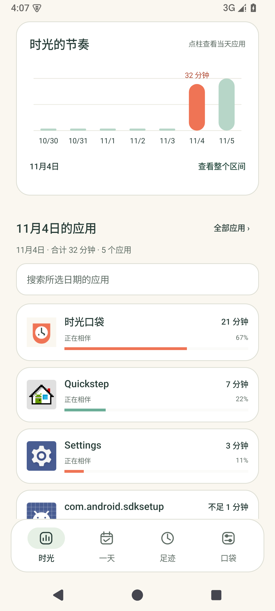
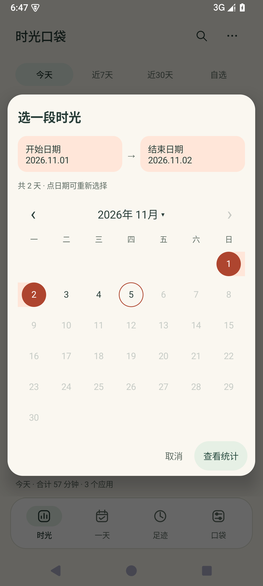
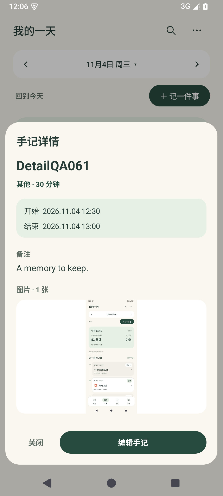

# 时光口袋 · Time Pocket

把用手机的时间、生活里的小事，装进自己的口袋。

一款完全离线的 Android 应用：统计应用使用时长、记录安装卸载足迹，用文字与图片留住每一天。数据保存在设备本地，不需要账号，也没有广告。

**Android 8.0+ · Java 17 · 原生 Android Views · SQLite · 当前源码版本 v0.6.11**

## 能做什么

| 页面 | 功能 |
| --- | --- |
| **时光** | 查看今天、近 7 天、近 30 天或自选日期的应用使用时长。点击图表按小时或日期筛选应用排行，也可查看单个应用的历史累计。 |
| **一天** | 按日期回看应用时间线，当天总用时与「时光」一致。可补记读书、散步等活动，支持分类、备注、跨夜记录和最多 3 张图片。打开已保存的手记会先看到详情。 |
| **足迹** | 查看安装与卸载两类记录，分别标明系统通知或清单补记。支持按应用、事件类型和日期组合筛选。 |
| **口袋** | 查看采集与权限状态、后台运行指引，手动刷新，导出或恢复本地 JSON 备份。 |

- **卸载后仍保留历史**：同一用户环境下，同包名应用重装后继续累计已保存的使用时长。
- **时间线更简洁**：隐藏桌面和不足一分钟的应用片段，再合并相邻同应用片段；最近的记录排在前面。
- **睡眠可以调整**：根据夜间停用区间推测睡眠，支持修改或标记“不作为睡眠”。
- **离线使用**：未声明 `INTERNET` 权限，不使用分析 SDK、广告 SDK 或自动云备份。

## 界面预览

<p>
  
  
  
</p>

截图来自开发模拟器：统计与日历为 v0.5.x，手记详情为 v0.6.1。截图中的测试内容不随应用安装，也没有示例模式。

## 开始使用

1. 从源码构建 APK，安装到 Android 8.0 或更高版本的设备上，构建方法见下文。
2. 打开应用，在「口袋」中前往系统设置，开启**使用情况访问权限**。
3. 使用其他应用后回到时光口袋，当前页面会自动更新。生活手记可以直接填写和查看。
4. OPPO / vivo / 一加用户可参考应用内后台运行指引，检查省电和自启动设置。
5. 定期将备份导出到本机目录；卸载时光口袋或清除其数据前，先备份。

本仓库提供源码，不把 APK、SDK 或签名密钥放入 Git。自行构建的调试签名可能与已有安装不同；签名不同无法直接覆盖安装。

## 统计能做到什么

- 应用通过 Android `UsageStatsManager` 读取前台使用事件，**没有读取系统数字健康或健康助手的私有数据库**，统计结果可能与系统页面不同。
- 启用采集或从长时间离线返回时，最多尝试补采近 7 天仍可读取的详细事件。补采范围受系统保留时间限制。
- 后台任务约每 15 分钟尝试采集，实际执行由系统决定。厂商省电、强制停止和权限回收都可能造成缺口。
- 足迹标记系统通知的接收时间，清单补记则标记发现变化的时间。进程不在时可能漏记。
- 睡眠属于推测，不能作为实际入睡、起床时间的测量结果。

详细的时间线规则、重装累计方式、备份行为与常见问题见 [使用与统计说明](docs/USAGE.md)。

## 权限与本地数据

| 权限声明 | 用途 | 是否需要手动操作 |
| --- | --- | --- |
| `PACKAGE_USAGE_STATS` | 读取系统应用使用事件 | 在系统设置中开启使用情况访问权限 |
| `QUERY_ALL_PACKAGES` | 查询应用清单、名称与图标，核对应用变化 | 无运行时授权弹窗 |
| `RECEIVE_BOOT_COMPLETED` | 支持系统持久化的周期采集任务跨重启保留 | 无运行时授权弹窗 |

不申请网络、相册读取、相机、定位、通知、无障碍或悬浮窗权限。添加图片和导出备份使用系统文件选择器；图片会保存为本地压缩副本。具体见 [隐私与数据说明](docs/PRIVACY.md)。

## 从源码构建

准备 **JDK 17**，并设置 `JAVA_HOME`。应用运行时不联网，首次下载构建工具仍需要网络。

```sh
git clone https://github.com/zhangkaibin0921/time-pocket.git
cd time-pocket
```

### Windows：直接使用 Android SDK 构建

另需 Python 3.10+。此路径不需要安装 Gradle：

```powershell
# 首次下载官方 SDK 到 .tools，并校验下载摘要。
python tools/bootstrap.py

# 运行 JVM 测试、编译、打包、调试签名和验签。
python tools/build.py
```

安装包为 `dist/time-pocket-0.6.11-debug.apk`。SDK 准备完成后，该构建路径可离线运行。如果已有 SDK，可设置 `ANDROID_HOME`，其中需安装 Platform 35 和 Build Tools 35.0.0。

### Android Studio / Gradle

打开项目根目录，使用 JDK 17、Android SDK 35。仓库附带 Gradle 8.11.1 Wrapper，Android Gradle Plugin 为 8.9.1，初次同步需联网。

```powershell
# Windows
.\gradlew.bat assembleDebug
```

```sh
# macOS / Linux
./gradlew assembleDebug
```

Gradle 输出：`app/build/outputs/apk/debug/app-debug.apk`。本次源码提交验证的是 Windows 直接 SDK 构建路径；没有把 Gradle / lint 或所有机型兼容性标为已验证。

完整构建、测试、签名与目录说明见 [开发指南](docs/DEVELOPMENT.md)。

## 测试

只有 JDK 17 和 Python 即可运行与 Android 解耦的回归测试：

```sh
python tools/test.py
```

覆盖使用事件归并、一天时间线和日期统计桶，v0.6.11 共 368 项断言。Android SQLite、备份及数据库升级测试需在设备或模拟器运行，步骤见 [开发指南](docs/DEVELOPMENT.md#android-数据库测试)。真机检查项目见 [设备验收清单](docs/DEVICE_CHECKLIST.md)。

## 项目结构

```text
app/src/main/          应用 Java 源码、资源和 Manifest
app/src/androidTest/   Android SQLite / 备份 / 升级测试
tests/                 不依赖 Android 的 Java 回归测试
tools/                 构建、测试、打包及模拟器辅助脚本
gradle/wrapper/        Gradle Wrapper
docs/                  使用、隐私、开发与验收说明
CHANGELOG.md           按版本整理的历史更新
```

欢迎通过 [Issues](https://github.com/zhangkaibin0921/time-pocket/issues) 反馈问题。复现信息与贡献说明见 [CONTRIBUTING.md](CONTRIBUTING.md)，版本变化见 [CHANGELOG.md](CHANGELOG.md)。

项目尚未指定开源许可证。仓库中的第三方工具许可见 [第三方说明](THIRD_PARTY_NOTICES.md)。
